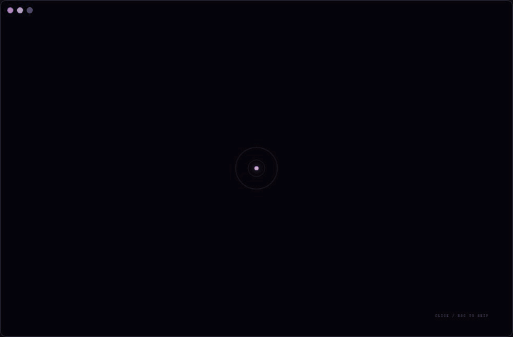

# Codex Startup Animation

为 Codex / ChatGPT 桌面应用添加可自定义的启动动画，以及动画结束后的静态背景。本项目是非官方外部启动器，需要先安装官方应用；它不会替换聊天、模型或工具功能，也不修改官方安装包。

## 效果演示



动图由项目自带的预览页面生成，展示默认素材与完整动画流程。

## 功能

- 约 12 秒的启动动画：头像、旋转圆环、碎片、角色轮廓与背景依次呈现。可按 `Esc` 跳过，并支持系统的“减少动态效果”设置。
- 自定义头像、背景、标题和字幕；更换背景时自动生成匹配的轮廓。
- 动画结束后保留静态背景；可调整背景显现程度，或关闭美化、恢复官方外观。
- 提供独立预览入口，无需启动官方应用即可查看动画。
- 图片和文字仅保存在本机，不会由本项目上传。

## 使用前准备

| 平台 | 要求 |
| --- | --- |
| Windows | Windows 11 x64；已安装 Microsoft Store 版 Codex / ChatGPT（包标识 `OpenAI.Codex`） |
| macOS | macOS 13 或更新版本；已安装官方 Codex / ChatGPT（应用标识 `com.openai.codex`）；从源码构建时需要 Xcode Command Line Tools |

Windows 已在 Windows 11 x64 构建 26200、官方应用 `26.1007.2314.0` 上验证；macOS 曾在官方应用 `26.924.22138` 上验证。官方应用更新后可能需要重新适配，其他系统或版本尚未保证兼容。

## Windows：下载与启动

1. 下载发布包 `Codex-Startup-Windows.zip`，解压到普通文件夹。请保留解压后的目录结构，不要直接在压缩包内运行脚本。
2. 保存正在进行的工作，并完全退出 Codex / ChatGPT；如果它仍在托盘运行，也需要从托盘退出。
3. 双击解压目录中的 `安装 ChatGPT 图标.cmd`。安装器会将启动文件复制到当前用户的 `%APPDATA%\CodexStartupAnimation`，并在桌面创建 `ChatGPT` 和 `ChatGPT 动画` 两个快捷方式。
4. 以后使用桌面的 `ChatGPT 动画` 启动动画；`ChatGPT` 快捷方式仍通过官方入口正常启动应用。

安装器会重新创建桌面的 `ChatGPT` 快捷方式。如果你已有同名快捷方式，请先确认是否需要保留它。安装完成后可以移动或删除下载时解压的文件夹，不影响新建的桌面入口。

不想安装桌面快捷方式时，也可以在解压目录中直接双击 `启动 Codex 动画.cmd`。`预览动画.cmd` 只在浏览器中预览动画，`检查兼容性.cmd` 用于检查本机官方应用的安装与运行环境。

如果应用已经由动画入口启动且仍在后台运行，再次点击 `ChatGPT 动画` 会连接已有实例；如果当前实例是通过官方入口启动，动画入口只会唤醒窗口并跳过本次动画，不会结束正在运行的任务。更多 Windows 说明见 [Windows 使用说明](README-Windows.md)。

### 从源码构建 Windows 发布包

在项目根目录打开 PowerShell，执行：

```powershell
powershell -ExecutionPolicy Bypass -File tools/build-windows.ps1
```

构建结果位于 `dist/Codex-Startup-Windows/`，同时生成 `dist/Codex-Startup-Windows.zip`。启动器使用官方应用附带的 Node.js，普通使用不需要安装 npm 依赖。

## macOS：构建与启动

在项目根目录执行：

```sh
bash tools/build-extension.sh
bash tools/build-macos.sh
```

构建后，`dist/Codex.app` 是动画启动入口，`dist/Aemeath Startup.app` 用于独立预览。先用 `⌘Q` 完全退出官方应用，再打开 `dist/Codex.app`，或双击项目根目录的 `扩展启动Codex.command`。如果官方应用已经在运行，启动器只会切回已有窗口，不会强制重启或重播动画。直接打开官方应用图标也不会播放本项目的动画。

## 自定义图片、文字与背景

动画播放中或结束后，Windows 按 `Ctrl+Alt+B`，macOS 按 `⌘⌥B` 打开设置。可以更换头像和背景、修改标题及字幕，并通过滑块调整动画结束后背景的显现程度。默认值为 42%；调到 0% 即不显示背景。

支持 PNG、JPEG、WebP，单张图片需小于 30 MB；非标准比例会居中裁切。修改后点击“保存并预览”即可应用。需要撤销自定义内容时，使用“恢复默认图片与文字”；需要恢复官方外观时，使用“关闭美化，恢复 Codex 外观”。

设置保存在本机 IndexedDB 中。独立预览与正式应用的设置互不共享；把发布包发给其他人，也不会自动附带你在设置面板中保存的个人配置。

## 安全与兼容说明

启动器会验证目标应用，并通过仅绑定 `127.0.0.1` 的临时调试连接接入主窗口；不修改官方应用包、账户或 API 配置，也不安装常驻后台服务。动画结束后会移除覆盖层，但会保留静态背景及设置所需资源。

调试端口会随本次官方应用进程保留。需要完全退出应用，再从官方图标重新打开，才能结束该调试状态。如果更新官方应用后动画失效，Windows 可先运行 `检查兼容性.cmd`；若接入失败，完全退出后仍可从官方入口正常启动应用。

## 参考来源

[参考说明](docs/references.md)
